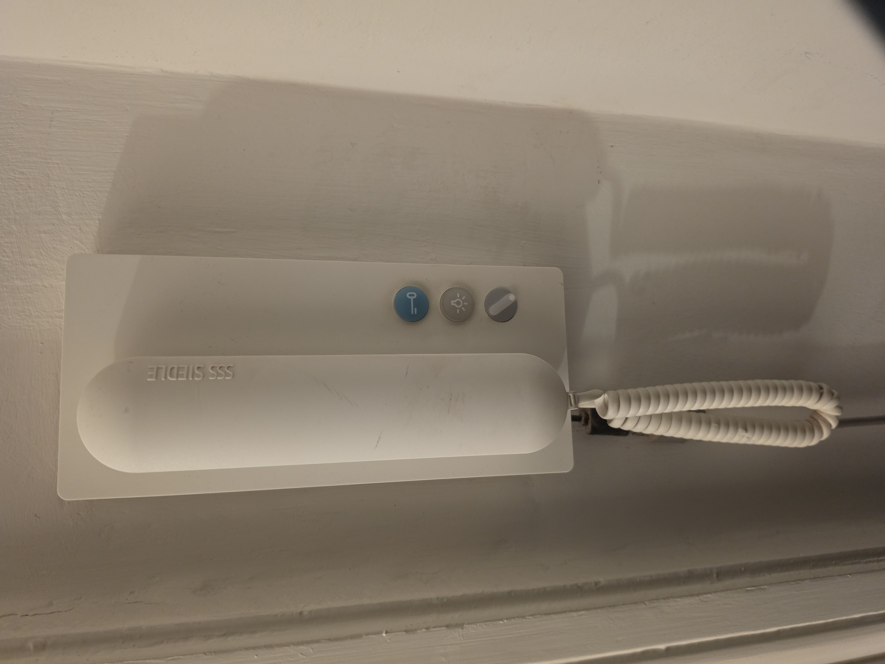
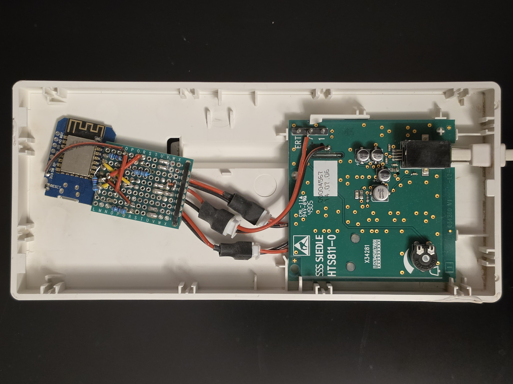
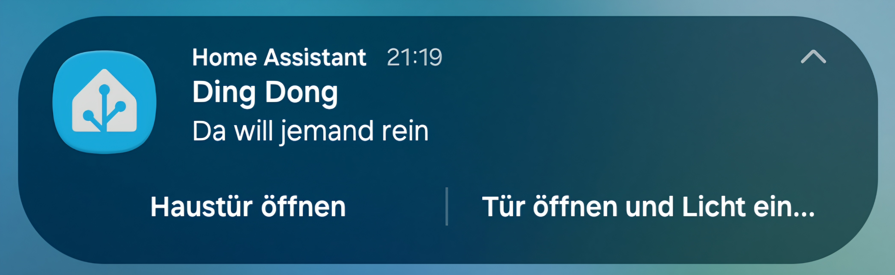
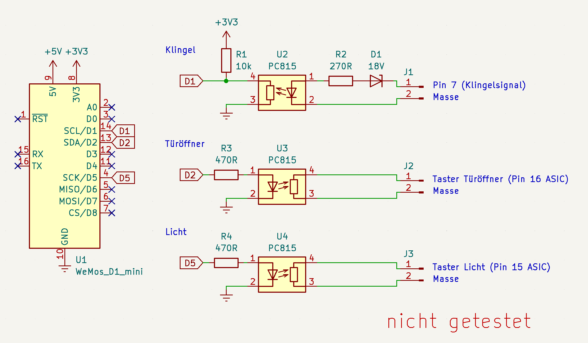
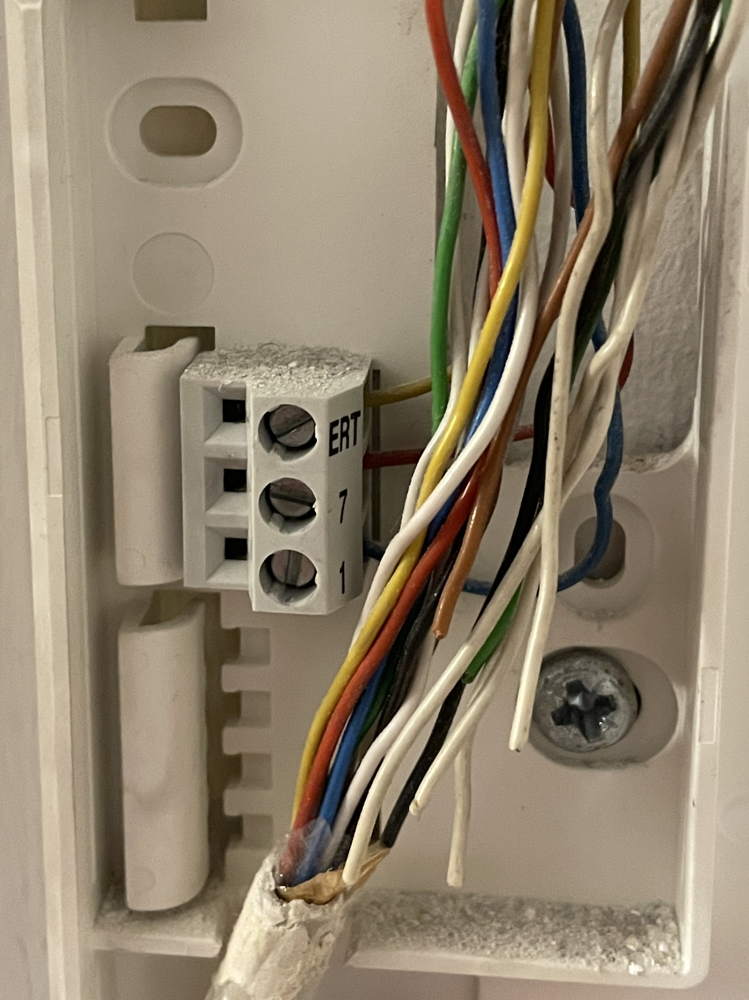
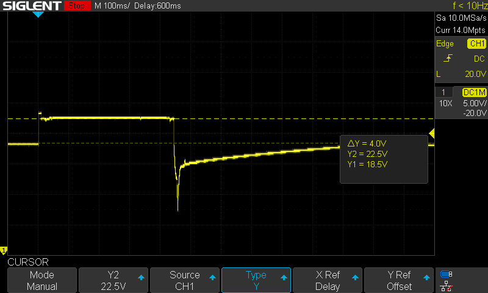
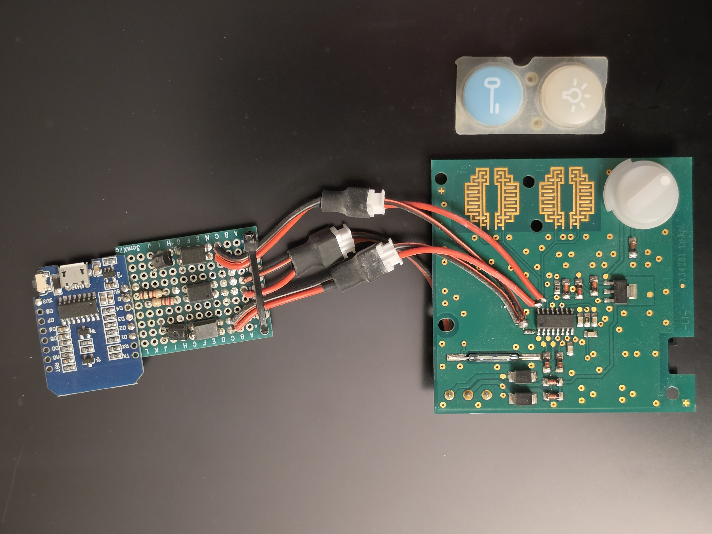
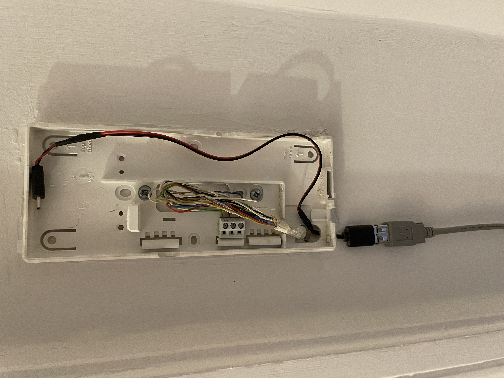
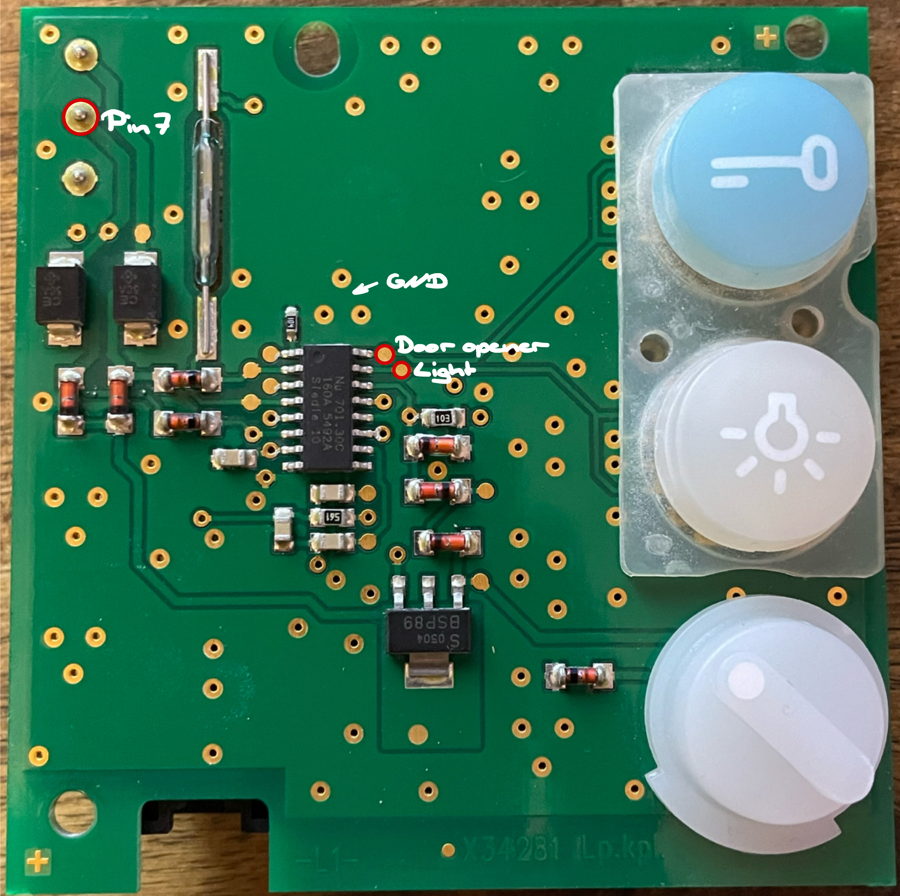
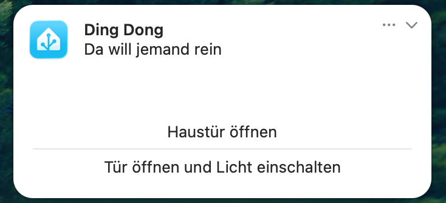

# Siedle HTS 811-0 Smart-Home-Klingelmodul

[-> 🇬🇧 English version](README.md)

 

 Dieses Projekt verbindet eine klassische Siedle HTS 811-0 Türsprechanlage mit dem WLAN und bindet sie in [Home Assistant](https://www.home-assistant.io/) ein. So lassen sich das Klingelsignal erkennen sowie Türöffner und Hausflurlicht über Home Assistant steuern.

## Funktionen

- **Klingelbenachrichtigung:** Home Assistant sendet eine Benachrichtigung, sobald an der Haustür geklingelt wird
- **Türöffner:** Die Haustür lässt sich direkt über die Benachrichtigung oder das Home Assistant-Dashboard öffnen
- **Hausflurlicht:** Das Licht im Hausflur kann ebenfalls über Home Assistant eingeschaltet werden

> [!IMPORTANT]
> Der Etagenruf (Klingeln an der Wohnungstür) ist ein separates Signal und liegt an einem anderen Pin der Türsprechanlage an, als das Signal der Haustürklingel. In diesem Projekt wird nur die Haustürklingel abgegriffen. Die Wohnungstür lässt sich ohnehin nur mechanisch öffnen, deshalb bietet mir die Einbindung des Etagenrufs in Home Assistant keinen nennenswerten Mehrwert.

## Hardware

| Komponente | Anzahl | Funktion |
|---|---:|---|
| Wemos D1 mini (ESP8266) | 1 | Steuerung und WLAN-Anbindung |
| Optokoppler | 3 | Galvanische Trennung zwischen Siedle-Anlage und ESP |
| 18 V Z-Diode | 1 | Erkennung des Klingelsignals |
| 10-kΩ-Widerstand | 1 | Pull-up |
| 470-Ω-Widerstand | 1 | Strombegrenzung |
| 270-Ω-Widerstand | 2 | Strombegrenzung |
| Lochrasterplatine | 1 | Trägerplatine für die Schaltung |

> [!CAUTION]
>
> Die hier aufgeführte Hardware und der Schaltplan entsprechen dem Aufbau, den ich heute verwenden würde. **Das gezeigte Design habe ich nicht getestet.** Die tatsächlich vor rund fünf Jahren (Feb. 2022) aufgebaute Schaltung, die auf den Fotos zu sehen ist, zeige ich lieber nicht in einem Schaltplan…

> [!NOTE]
> Die Lochrasterplatine war ursprünglich nur als Prototyp gedacht. Aber bekanntlich hält nichts länger als ein Provisorium.

## Funktionsweise

### Klingelsignal

Die Siedle Klingelanlage besteht aus zwei Teilen: einer Basisstation (meist im Keller des Mehrfamilienhauses) und je einer Türsprechanlage in jeder Wohnung. Die Basisstation ist direkt mit den jeweiligen Türsprechanlagen über zwei Pins (Pin 7 und Pin 1) verbunden. Über einen dritten Pin wird das Signal für den Etagenruf (ERT) übertragen

Im Ruhezustand liegen an Pin 7 der Türsprechanlage etwa 18 V an (s. Oszilloskop-Screenshot). Wird die Haustürklingel betätigt, steigt die Spannung auf ungefähr 22 V. Nach kurzer Verzögerung gibt die Türsprechanlage den Klingelton aus. Dieser ertönt, bis die Spannung an Pin 7 auf etwa 8 V absinkt. Anschließend pendelt sich die Ruhespannung langsam wieder bei ungefähr 18 V ein.

Das Smart-Home-Modul erkennt mithilfe einer Zenerdiode den Spannungsanstieg von 18 V auf 22 V. Dadurch wird der Optokoppler angesteuert, dessen Ausgang mit dem ESP8266 verbunden ist.

### Türöffner und Hausflurlicht

Der Türöffner und das Hausflurlicht lassen sich normalerweise über Tasten an der Türsprechanlage schalten. Beim Drücken einer Taste werden zwei Leiterbahnen auf der Platine miteinander verbunden. Dadurch wird Pin 15 bzw. Pin 16 des ASICs (des Steuerbausteins der Türsprechanlage) auf GND gezogen.

Das Smart-Home-Modul bildet diesen Tastendruck mit einem Optokoppler nach: Der Optokoppler überbrückt für einen kurzen Moment die entsprechenden Kontakte.

 

### Stromversorgung

 Der ESP8266 wird über ein externes 5-V-USB-Netzteil versorgt. Da sich in meinem Fall eine Steckdose in der Nähe der Türsprechanlage befindet, war das die einfachste Lösung. Das USB-Kabel lässt sich von unten bzw. von hinten in das Gehäuse führen, ohne die Türsprechanlage dafür zu verändern.

 

### Einbau

Im Gehäuse der Türsprechanlage ist ausreichend Platz für die Platine.

Um die Anlage von der Wand abzunehmen, muss an der Unterseite zwischen Wand und Rahmen ein kleiner Clip reingedrückt werden. Anschließend lässt sich die Türsprechanlage mit der Unterkante zuerst von der Wand lösen.

Für den Anschluss werden die drei Optokoppler an insgesamt vier Kontaktpunkten mit der Platine der Türsprechanlage verbunden:

1. **Masse (GND)**: Jeder Optokoppler muss auf der Seite der Türsprechanlage mit dessen Masse verbunden werden
2. **Pin 7:** Klingelsignal (im Betrieb etwa 22 V)
3. **Taster für den Türöffner:** die nicht mit Masse verbundene Seite des Tasters
    (verbunden mit Pin 16 des SO-16-ASICs)
4. **Taster für das Hausflurlicht:** die nicht mit Masse verbundene Seite des Tasters
    (verbunden mit Pin 15 des SO-16-ASICs)

Die Optokoppler bilden die Schnittstelle zwischen der Türsprechanlage und dem ESP8266. So können das Klingelsignal erfasst und die beiden Schaltfunktionen ausgelöst werden, ohne die GPIOs des ESP8266 direkt mit der Siedle-Schaltung zu verbinden.

> [!NOTE]
> Die Türsprechanlage lässt sich weiterhin wie gewohnt bedienen. Die ursprünglichen Tastenfunktionen bleiben erhalten. Auch die Basisstation sollte von den Änderungen aufgrund der galvanischen Trennung unbeeinflusst sein.

## Home Assistant

Der ESP8266 kommuniziert per WLAN mit Home Assistant. Auf dem ESP läuft eine [ESPHome](https://esphome.io/) firmware.

### ESPHome-Konfiguration

[ESPHome Konfiguration](config/esphome.de.yaml)

Der ESP stellt drei Sensoren / Switches bereit:

-   Klingel (binary sensor)
-   Haustüröffner (switch)
-   Hausflurlicht (switch)

Die beiden Schalter werden nach 100 ms automatisch wieder ausgeschaltet. Dadurch entsteht ein kurzer Schaltimpuls, der den Tastendruck an der Türsprechanlage nachbildet.

> [!NOTE]
> Die Konfiguration soll als Vorlage dienen. Sie enthält secrets und beispielhafte Entity-IDs. Passe sie einfach für deine Bedürfnisse an.

### Home Assistant-Automation

 

 

[Home Assistant-Automation Konfiguration](config/homeassistant_automation.de.yaml)

Die Automation in Home Assistant ermöglicht es, über eine Aktionsbenachrichtigung auf dem Smartphone oder Laptop die Haustür zu öffnen, sobald jemand klingelt. Zusätzlich kann das Hausflurlicht eingeschaltet werden.

Die Automation wartet bis zu 20 Sekunden auf eine Aktion. Wird in dieser Zeit keine passende Aktion ausgelöst, wird die Benachrichtigung entfernt.

Geht eine Person richtung Wohnungstür, wird die Haustür automatisch geöffnet.

> [!NOTE]
> Die Automation soll als Vorlage dienen. Sie enthält Platzhalter und beispielhafte Entity-IDs. Passe sie einfach für deine Bedürfnisse an.

## Hinweise zur Sicherheit und Kompatibilität

>   [!Warning]
>
>   - Der Einbau und Betrieb erfolgen auf eigene Verantwortung.
>   - Die elektrische Kompatibilität muss vor dem Anschluss geprüft werden. Die genannten Spannungswerte sind Erfahrungswerte und können in anderen Einbauten des selben Herstellers abweichen.
>   - Arbeiten an der Türsprechanlage sollten nur von Personen durchgeführt werden, die die elektrischen und technischen Risiken einschätzen können.

>   [!Caution]
>
>   Die Fernsteuerung des Türöffners stellt ein potenzielles Sicherheitsrisiko dar, da sie bei einem kompromittierten System für unbefugten Zutritt missbraucht werden könnte.

## Disclaimer

Dieses Projekt dient ausschließlich privaten Bastel- und Lernzwecken. Es wird keine Gewähr für die Funktion oder Kompatibilität mit anderen Siedle-Anlagen übernommen.

**Siedle** ist eine eingetragene Marke des jeweiligen Rechteinhabers. Dieses Projekt steht in keiner Verbindung zu Siedle.

## Weiterführende Informationen

Vielen Dank an Richi für den sehr ausführlichen Blogbeitrag zur Türsprechanlage: [Siedle – Analyse und Einblicke bei Richis-Lab](https://www.richis-lab.de/Siedle.htm). Wer mehr über den technischen Aufbau der Türsprechanlage erfahren möchte, ist dort gut aufgehoben.

## Lizenz und Urheberrecht

Dieses Projekt verwendet zwei Lizenzen:

-   **Quellcode:** [PolyForm Noncommercial 1.0.0](https://polyformproject.org/licenses/noncommercial/1.0.0/)
-   **Hardware, Schaltpläne und Dokumentation:** [CC BY-NC-SA 4.0](https://creativecommons.org/licenses/by-nc-sa/4.0/)

### Nutzungsbedingungen

-   Ausschließlich nicht-kommerzielle Nutzung.
-   Namensnennung von **thamow** mit Link zu diesem Repository.
-   Änderungen und Weitergabe müssen den jeweiligen Lizenzbedingungen entsprechen.
-   Kommerzielle Nutzung nur mit vorheriger schriftlicher Zustimmung.

**Copyright (c) 2026 thamow**
Originalprojekt: https://github.com/thamow/Smart-Doorbell

CC BY-NC-SA 4.0  
Non-commercial, attribution and share-alike.

