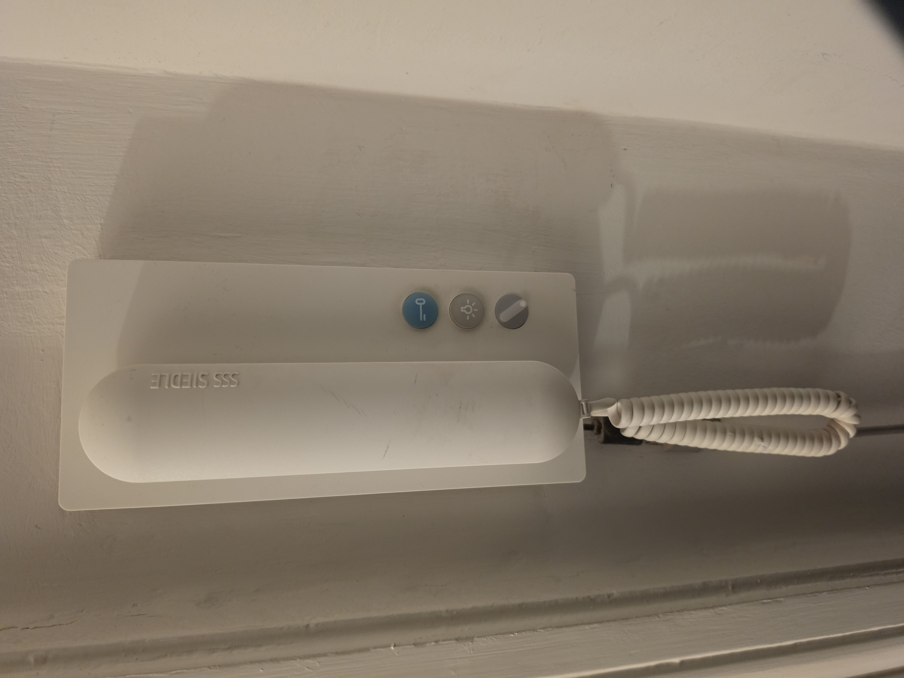
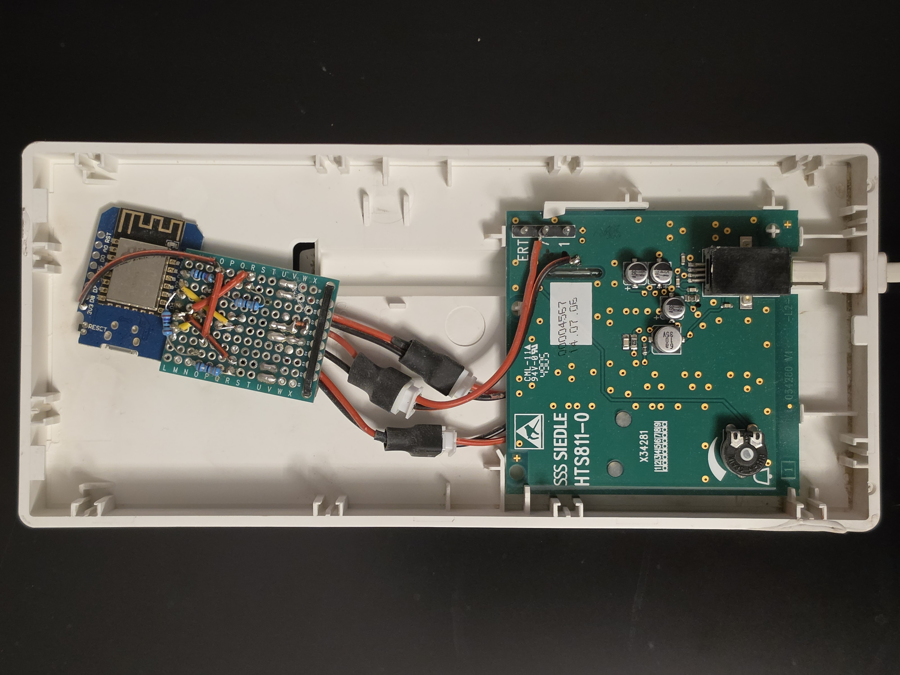
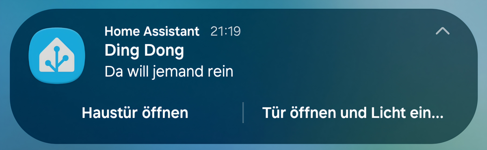
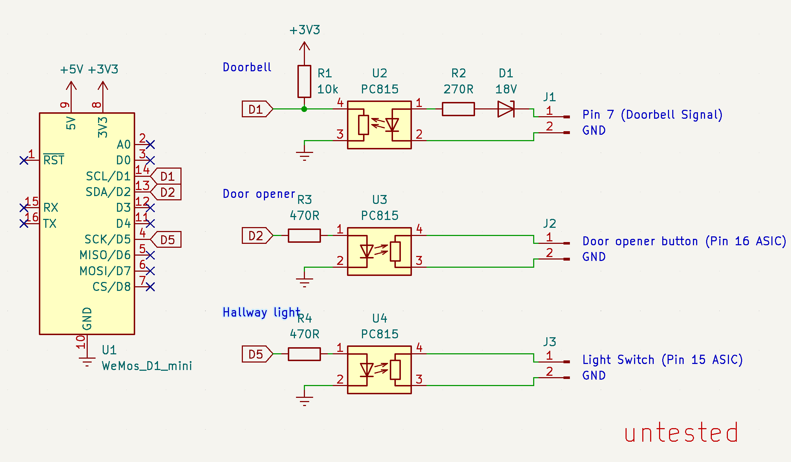
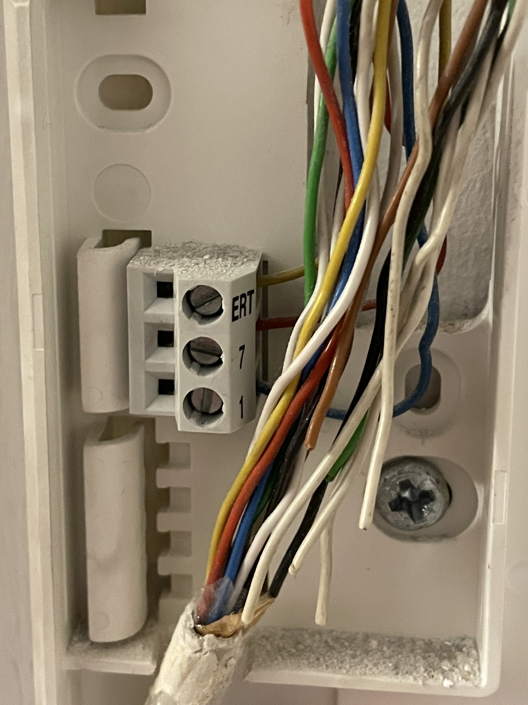
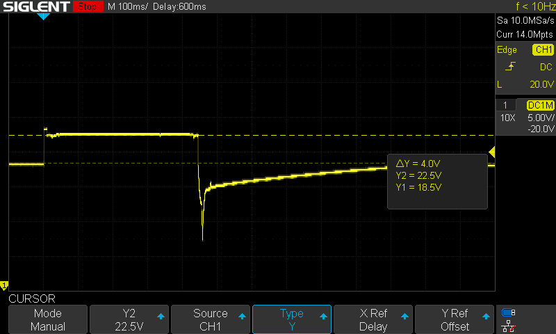
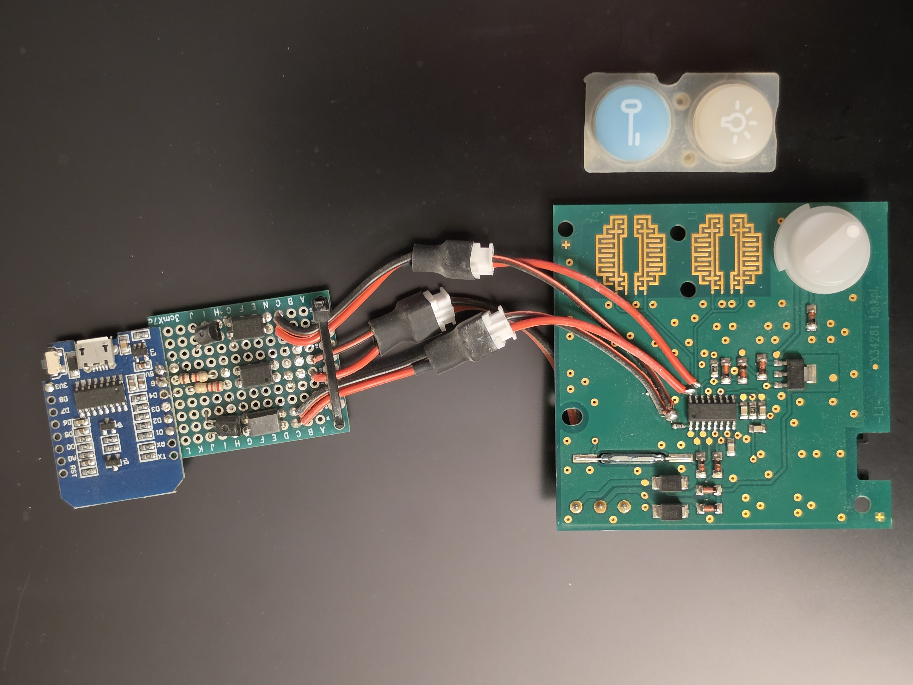
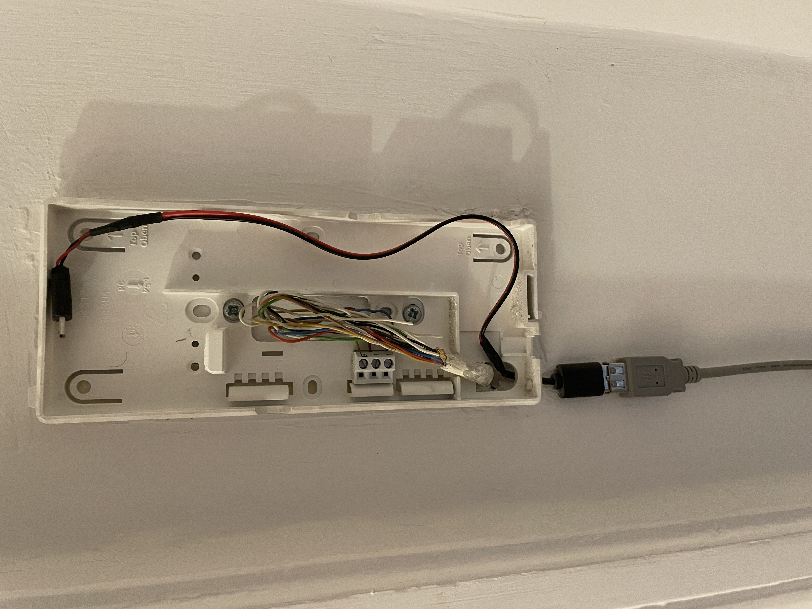
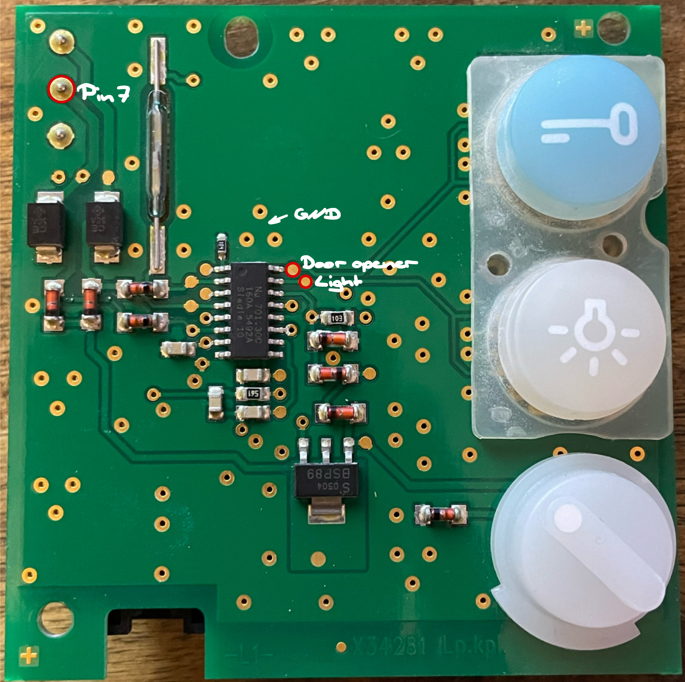
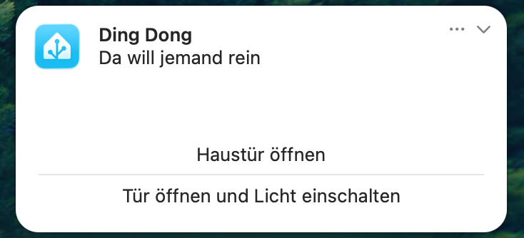

# Siedle HTS 811-0 Smart Home Doorbell Module

[-> 🇩🇪 Deutsche Version](README.de.md)

 

 This project connects a classic Siedle HTS 811-0 door intercom system to Wi-Fi and integrates it with [Home Assistant](https://www.home-assistant.io/). This makes it possible to detect the doorbell signal and control the door opener and hallway light through Home Assistant.

## Features

- **Doorbell notifications:** Home Assistant sends a notification whenever someone rings the main entrance doorbell
- **Door opener:** The main entrance door can be unlocked directly from the notification or via the Home Assistant dashboard
- **Hallway light:** The hallway light can also be switched on through Home Assistant

> [!IMPORTANT]
> The apartment-floor call (the bell at the apartment door) is a separate signal and uses a different pin on the intercom than the main entrance doorbell. This project only monitors the main entrance doorbell. Since I can only open my apartment door mechanically anyway, integrating the floor call into Home Assistant would not provide much additional value for me.

## Hardware

| Component               | Quantity | Purpose                                                  |
| ----------------------- | -------: | -------------------------------------------------------- |
| Wemos D1 mini (ESP8266) |        1 | Control and Wi-Fi connectivity                           |
| Optocouplers            |        3 | Galvanic isolation between the Siedle system and the ESP |
| 18 V Zener diode        |        1 | Detecting the doorbell signal                            |
| 10 kΩ resistor          |        1 | Pull-up                                                  |
| 470 Ω resistor          |        1 | Current limiting                                         |
| 270 Ω resistor          |        2 | Current limiting                                         |
| Perfboard               |        1 | Circuit board for the module                             |

> [!CAUTION]
> The hardware listed here reflects what I would use today. **I have not tested the circuit design shown here.** The circuit I actually built around five years ago is different. And let's just say, it's not my proudest work…

> [!NOTE]
> The perfboard was originally intended to be a prototype or temporary solution. But, as the saying goes, nothing lasts longer than a temporary fix.

## How It Works

### Doorbell Signal

In this setup, the Siedle intercom system consists of two parts: a base station (usually located in the basement of the apartment building) and one door intercom unit in each apartment. The base station is connected to the individual apartment intercoms via two pins (pin 7 and pin 1). A third pin carries the signal for the apartment-floor call (ERT)

In standby mode, approximately 18 V is present at pin 7 of the door intercom. When someone presses the main entrance doorbell, the voltage rises to around 22 V. After a short delay, the intercom plays the ringtone. The ringtone continues until the voltage at pin 7 drops to approximately 8 V. The voltage then gradually settles back to its standby level of around 18 V.

The smart home module detects the voltage increase from approximately 18 V to 22 V using a Zener diode. This activates the optocoupler, whose output is connected to the ESP8266.

### Door Opener and Hallway Light

 The door opener and hallway light can normally be operated using buttons on the intercom. Pressing one of these buttons connects two traces on the circuit board. This pulls pin 15 or pin 16 of the ASIC (the intercom's control chip) down to GND.

The smart home module emulates these button presses using optocouplers: each optocoupler briefly bridges the corresponding contacts.

 

### Power Supply

 The ESP8266 is powered by an external 5 V USB power supply. In my case, there is a power outlet near the intercom, so this was the simplest solution. The USB cable can be routed into the enclosure from the rear without modifying the intercom itself.

 

### Installation

There is plenty of room for the circuit board inside the intercom enclosure.

To remove the unit from the wall, press a small clip at the bottom, between the wall and the frame. The intercom can then be lifted away, starting with the bottom edge.

The three optocouplers need to be connected to a total of four contact points on the intercom's circuit board:

1. **Ground**
2. **Pin 7:** Doorbell signal (approximately 22 V during operation)
3. **Door opener button:** The side of the button that is not connected to ground
    (connected to pin 16 of the SO-16 ASIC)
4. **Hallway light button:** The side of the button that is not connected to ground
    (connected to pin 15 of the SO-16 ASIC)

The optocouplers provide the interface between the intercom and the ESP8266. This allows the doorbell signal to be detected and both switching functions to be triggered without connecting the ESP8266 GPIO pins directly to the Siedle circuit.

> [!NOTE]
> The intercom can still be operated as usual, with all of its original button functions remaining fully operational. Thanks to the galvanic isolation, the modification should be completely transparent to the base station.

## Home Assistant

The ESP8266 communicates with Home Assistant over Wi-Fi. The following configuration uses [ESPHome](https://esphome.io/).

### ESPHome Configuration

[ESPHome configuration](config/esphome.yaml)

The ESP exposes three entities:

-   Doorbell (binary sensor)
-   Door opener (switch)
-   Hallway light (switch)

Both switches automatically turn off after 100 ms, generating a short pulse that emulates pressing a button on the door intercom.

>   [!NOTE]
>
>   The configuration is intended as a template. It uses secrets and example entity IDs. Simply adapt it to your needs.

### Home Assistant Automation

 

 

[Home Assistant automation config](config/homeassistant_automation.yaml)

The automation sends an actionable notification when the doorbell rings. The notification can be used to unlock the main entrance door, optionally switching on the hallway light as well.

The automation waits up to 20 seconds for an action. If no matching action is received during that time, the notification is cleared.

 If a person approaches the appartment door, the main entrance door is unlocked automatically.

> [!NOTE]
> The automation is intended as a template. Make sure to review and adapt this behavior to your own liking.

## Safety and Compatibility Notes

>   [!Warning]
>
>   -   Installation and operation are at your own risk.
>   -   Electrical compatibility must be checked before making any connections. The voltage values listed above are observations from the setup described here and may vary in other installations of the same manufacturer
>   -   Work on the intercom should only be carried out by people who can assess the electrical and technical risks involved

>   [!Caution]
>
>   Enabling remote door unlocking introduces a security risk. If compromised, the system could potentially be used to gain unauthorized access to the building.

## Disclaimer

This project is intended solely for private DIY and educational purposes. No guarantee is given regarding its functionality or compatibility with other Siedle systems.

**Siedle** is a registered trademark of its respective owner. This project is not affiliated with Siedle.

## Further Reading

Many thanks to Richi for the detailed blog post about the intercom system: [Siedle — Analysis and Technical Details at Richis-Lab](https://www.richis-lab.de/Siedle.htm). If you would like to learn more about the intercom's technical design, this article is a good place to start.

## License and Copyright

This project uses two licenses:

-   **Source code:** [PolyForm Noncommercial 1.0.0](https://polyformproject.org/licenses/noncommercial/1.0.0/)
-   **Hardware, schematics and documentation:** [CC BY-NC-SA 4.0](https://creativecommons.org/licenses/by-nc-sa/4.0/)

### Terms of use

-   Non-commercial use only.
-   Credit **thamow** and link to this repository.
-   Modifications and redistribution must follow the respective license.
-   Commercial use requires prior written permission.

**Copyright (c) 2026 thamow**
Original project: https://github.com/thamow/Smart-Doorbell

CC BY-NC-SA 4.0   
Non-commercial, attribution and share-alike.

